# pm-watcher · World Cup Cross-Platform Pricing Monitor

*by Yixuan · [中文版](./README.zh-CN.md)*

<a href="https://github.com/yixuuuan/pm-watcher/releases/tag/keynote-film">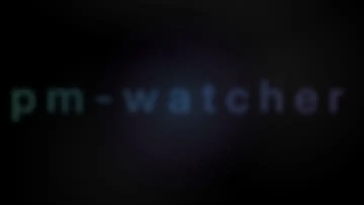</a>

<p align="center"><b><a href="https://github.com/yixuuuan/pm-watcher/releases/download/keynote-film/pm-watcher-keynote-1080p.mp4">▶ Watch the film · 2:50</a></b> &nbsp;·&nbsp; <a href="https://github.com/yixuuuan/pm-watcher/releases/download/keynote-film/pm-watcher-keynote-HD.mp4">HD</a></p>

> 🏆 **The 2026 World Cup is over. pm-watcher is now a permanent, static archive.**
> Open **[pmwatcher.wy-x.com](https://pmwatcher.wy-x.com/)**, pick any moment from the opener to the final, and see exactly what the live board showed then — drag the timeline or press play.
> Full-tournament recap: **[were the markets right?](https://pmwatcher.wy-x.com/analysis.html)**

One World Cup, five prediction markets, five different answers. pm-watcher put Polymarket, Kalshi, 42, Manifold and Predict.fun side by side as they priced the 2026 World Cup in real time — where they agreed, where they diverged, and, once the final whistle blew, who was right.

> A **read-only analysis tool.** It places no orders, connects no wallet, and needs no platform account. It answers *"what does the market think,"* not *"how do I bet."*

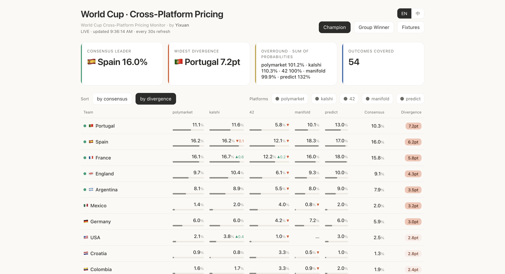

## The archive in numbers

| | |
|---|---|
| Tracking window | 11 Jun – 5 Aug 2026 |
| Platforms | 5 |
| Matches priced | 104 of 104 |
| Pricing changes recorded | ~200,000 |
| Teams | 48 |

## What the data says

- **Favourites delivered 68% of the time** (71 of 104). The rate fell as the stakes rose: nearly 9 in 10 in the Round of 32, 1 in 2 from the quarter-finals on.
- **Draws were overpriced.** Markets implied 28%. 19% happened.
- **The champion was not the favourite.** Spain opened at ~15%, second to France at ~18%. France finished fourth.
- **The largest miss:** Spain 0–0 Cape Verde. The draw was priced at 6%.
- **Accuracy (Brier score, lower is better).** Predict.fun (0.470) and Kalshi (0.471) led. Polymarket (0.497) trailed. The five-platform consensus (0.493) did not beat the best single market.

  *Caveat: platforms listed different subsets of matches (88–104), so the ranking is indicative, not a controlled comparison. Manifold listed no single-match markets and appears only in the title race.*

Every figure above is recomputed from the archive by [`archive/analyze.py`](./archive/analyze.py) and shown in full on the [recap page](https://pmwatcher.wy-x.com/analysis.html).

## How the archive works

The live service polled five platforms every 30 seconds. After the final it became a static site: no server, no database, no API token.

- **Replay, not screenshots.** A thin layer ([`archive/web/archive.js`](./archive/web/archive.js)) feeds the original front end. For any moment *T*, it recomputes in the browser what the server would have returned at *T*, using the same logic as `serve.py` and `history.py`. Every board — champion, fixtures, recap, team cards, knockout, Champion Machine, news timeline, danmaku — runs unchanged.
- **Verified bit-for-bit.** The original Python, run on the database truncated to *T*, was diffed against the browser at 20 timestamps: 11,808 fields, all identical, rounding included.
- **Every moment is a link.** `?t=2026-06-25T2030Z` opens the same instant in any time zone.
- **Privacy.** The raw database holds hashed visitor IPs and stays private. The public repo carries only exported pricing, results and daily visit totals.

Details and rebuild steps: [`archive/README.md`](./archive/README.md).

## What the board shows

- **Champion board** — title odds for all 48 teams, five platforms side by side, plus a consensus price and a divergence heatmap (darker = the platforms disagree more)
- **Group winner** — qualifying odds for all 12 groups (data from Kalshi and 42)
- **Fixtures** — all 104 matches, group stage to final, generated from the platforms' own markets; tap any match for a cross-platform Win / Draw / Loss comparison and the spread
- **Knockout** — the road-to-the-final bracket with **true two-half seeding** and a qualification tracker that **forward-propagates decided winners** into the next round; the Parallel-Universe Champion Machine renders **inline in this tab** (below)
- **News × odds** — a BBC / Guardian / ESPN / Sky football feed plus Dongqiudi (Chinese), filtered by team; **tap a story to see that team's per-platform odds for ±3 hours around it** (the dashed red line marks the news timestamp)
- **News danmaku** — headlines drift across the top as bullet-screen pills; hover to pause and read, click to open, and a top-right button toggles the stream off
- **Persisted history** — every odds change was written to SQLite (change-driven: nothing is stored while a price holds steady). The result is a complete record of how five markets priced 104 matches — the dataset the archive replays
- **Telegram alerts** — optional push when a cross-platform spread crosses your threshold (live mode only)
- **Bilingual UI** — English / 中文 toggle, top right

**A fixture expanded into a five-platform Win / Draw / Loss comparison:**

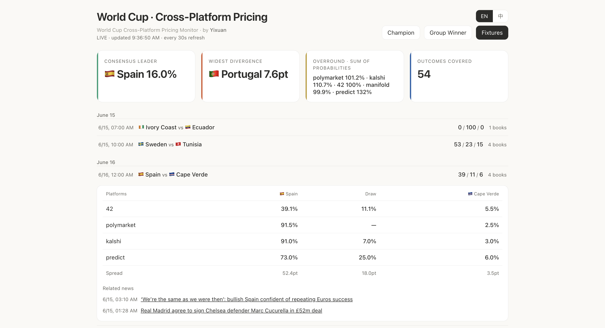

**Tap a news story to see the two teams' odds around it; ⚡ marks consensus moves the monitor caught:**

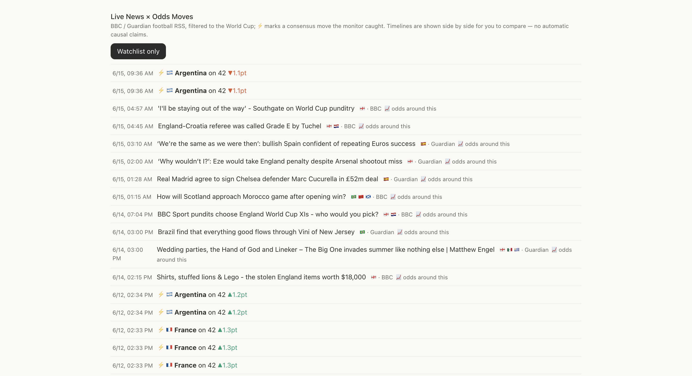

**News danmaku — headlines drift across the top like a bullet-screen; hovering a pill pauses it so you can read or click through, and the top-right button turns the stream off:**

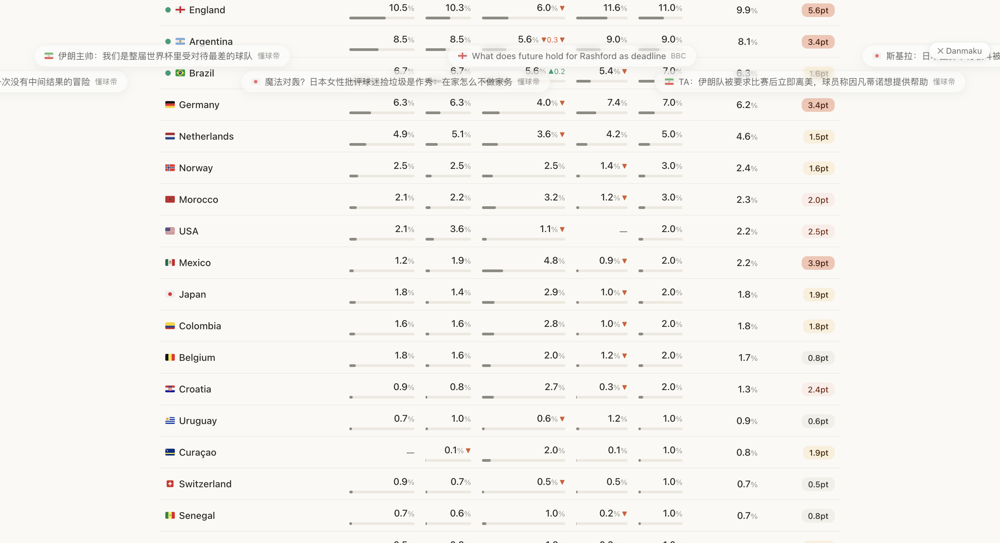

**News × odds in one picture — a story's timestamp dropped onto each platform's price line for the hours around it, so the relationship between a headline and a price move is visible at a glance (a temporal relationship, not a causal claim):**

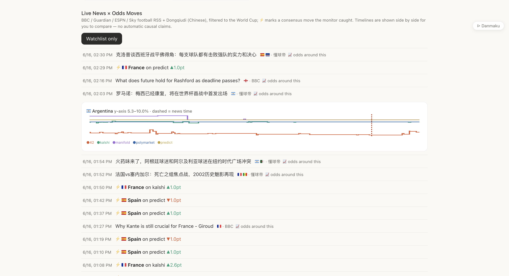

**A selectable watchlist — each card shows per-platform odds and a multi-platform history line:**

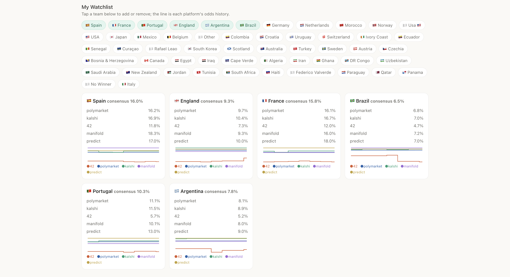

## The Parallel-Universe Champion Machine

The knockout rounds turn every fan into a counterfactual thinker: *what would it take for **my** team to win it all?* The Champion Machine answers with a collectible artifact. Pick any of the **32 knockout teams** on a radial sci-fi selector; the machine reverse-derives that team's championship path **along the real bracket** — five rounds, five opponents — and stamps the whole story onto a die-cut **champion's match ticket** you can download and share. It lives **inside the Knockout tab** — no page jump — in an auto-sizing embed, with a one-click full-screen view.

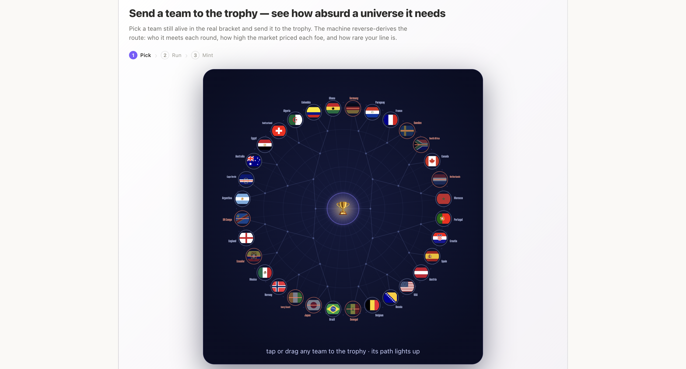

**Five verdicts on a ticket.** Each round of the path is a stamped module: the opponent, a meme-grade verdict in a double-printed rubber stamp (drawn from a hand-built corpus of player lore, tactical folklore and football superstition), a one-line story, two derivative hashtags, a parallel-universe scoreline (AET and penalty drama included) — and the market's pre-match price for that opponent, struck through and stamped **MISPRICED** or **BROKEN**. Every re-roll rotates the whole corpus, so verdicts change on each pull and never repeat within a ticket.

**Rarity as a blind-box tier.** The joint probability of the whole path sets the tier — STANDARD / RARE / EPIC / **LEGENDARY** (gold-foil frame) — and eliminated teams mint as **HIDDEN**: a universe that has already ended in reality is the rarest kind you can hold.

**A ticket that stays alive.** The machine syncs finished knockout results from the board's own recap data. Legs the team has actually won are stamped **✓ VERIFIED** and show the **real scoreline** — penalty shootouts included (`1–1 PENS`) — while the **universe lifeline** reads *alive · 2/5 verified*, or *ended @ Round of 16*. In the archive, the ticket reflects the moment you replay.

**National identity in the texture.** Every nation gets a signature motif woven into the ticket — seigaiha waves for Japan, a sunburst for Argentina, the šahovnica check for Croatia, zellige stars for Morocco, the Aztec greca for Mexico, St George's cross for England… — plus a punched perforation line, a barcode stub, and a triangular die-cut edge.

**Built to be shared.** One-tap export produces a presentation-ready PNG with a soft drop shadow tracing the die-cut teeth; a bilingual, auto-generated caption (team, rarity tier, final verdict, alive/ended hook) is copied to the clipboard the moment it finishes. On phones the ticket opens in a **long-press-to-save** sheet instead of a silent download, and the radial selector is tuned for touch drag. Every ticket carries a **scannable QR code and printed URL** deep-linking back to the machine, plus its **price-snapshot timestamp** — calibration language, not prophecy.

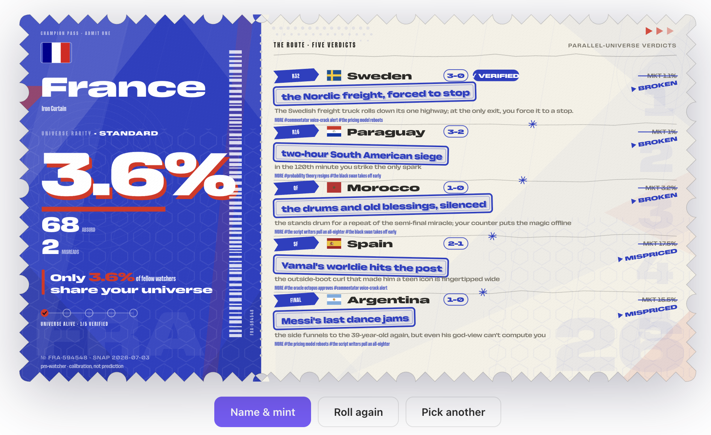

> The Champion Machine is entertainment built on market data. Rarity measures **how the five markets jointly priced a path**, not how good a team is. A built-in banned-words lint keeps every generated line — verdicts, stories, captions — free of betting language. Calibration, not prediction, all the way down.

## Retrospective board & team cards

Once a match is over, the question changes from *"what will happen"* to ***"who priced it right — and how wrong were the rest?"*** A retrospective layer under the project's guiding idea: **calibration, not prediction**.

### Match Recap board

- **Priced-vs-actual recap** for every finished match: the pre-match five-platform consensus set against the real Win / Draw / Loss result, with a hit-or-miss verdict.
- A **market-consensus record** pinned to the top — how often the consensus favourite actually delivered — with one-tap *delivered / fell-short* filtering.
- **Platform calibration**: a calibration chart plus a **Brier-score accuracy ranking** of the five platforms.
- A **shareable one-line headline** on every card — varied, not templated, bilingual (English headline with a Chinese sub-line in 中文 mode).
- Horizontal **date tabs** to jump to any match-day.
- **One-tap card export** (1080×1350 PNG) carrying the headline, the five-platform table, and a **QR code + link** back to the board.

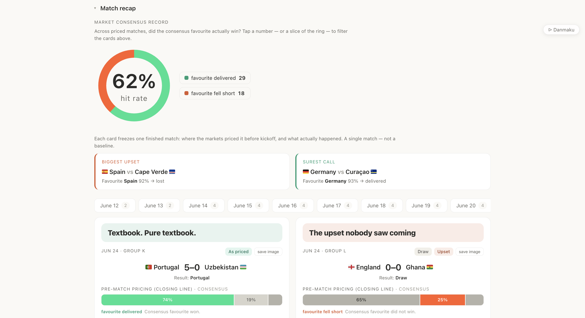

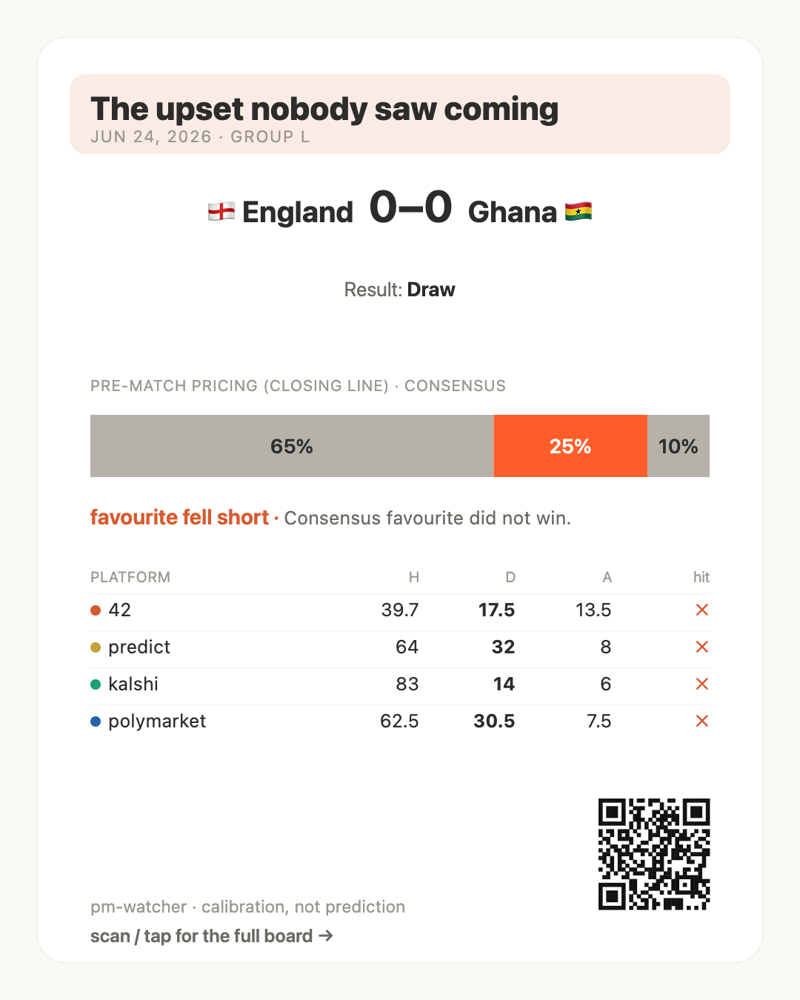

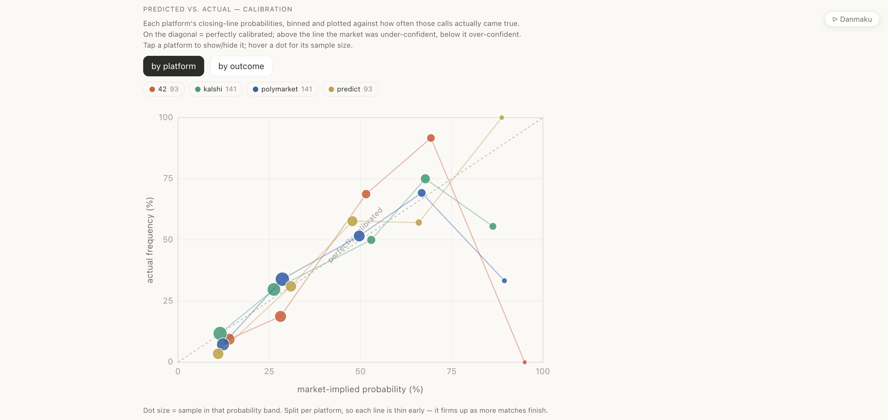

### Team cards

- A collectible **card for all 48 nations** in the official WC26-poster visual language — every nation has a **fixed colour + texture** (12 bold textures, no two alike), locked so only the data updates.
- A **Surprise Index** (S / A / B / C, 0–100) and a giant **±% gap** number: how far the market's pricing missed that team's actual results (it measures how wrong the market was, not a team's strength).
- Record, GF / GA, upsets made, and the team's single most surprising match.
- **One-tap PNG export** with a QR deep-link straight to that team; bilingual EN / 中文; gold stars for past champions.

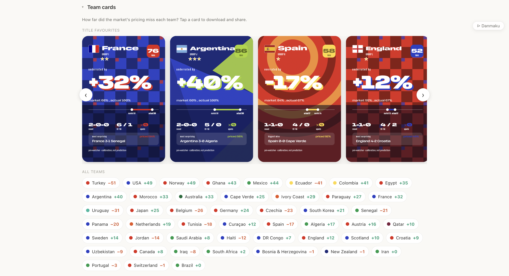

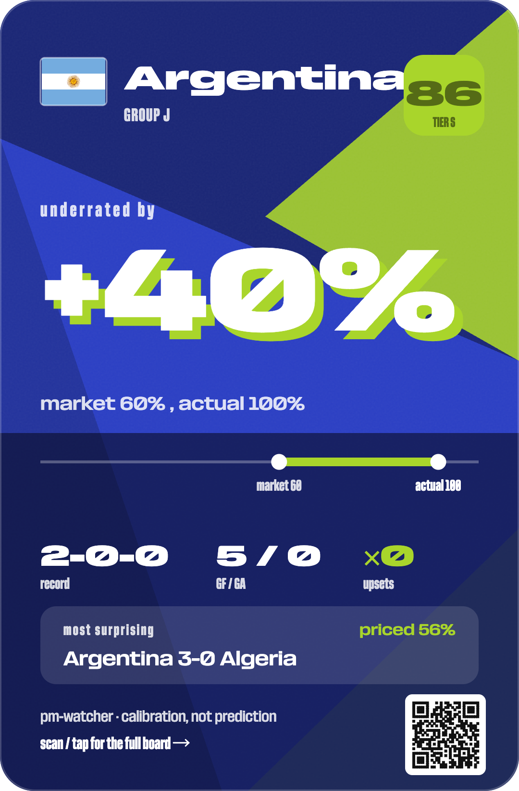

> Both boards are **retrospective and read-only** — they describe how the markets priced matches that have *already* happened. Still no prediction, no betting.

## Quick start

**Browse the archive** — nothing to install: [pmwatcher.wy-x.com](https://pmwatcher.wy-x.com/).

**Rebuild the static site** from a history database:

```bash
python3 archive/build_site.py --db history.db --site-url https://pmwatcher.wy-x.com/
python3 -m http.server 8765 -d site          # open http://localhost:8765
```

The site is hosted on Cloudflare Pages (output directory `site`, no build command). See [`archive/README.md`](./archive/README.md) for news backfill and the optional visit counter.

**Run the live monitor** — the original service, for reference. The 2026 markets have settled, so it will find little to show; the code is the point.

```bash
pip install -r requirements.txt

# Web dashboard:
python3 -m pm_watcher.serve --live --interval 30
# then open http://127.0.0.1:8765
# the Champion Machine is embedded in the Knockout tab (full-screen at /parallel-universe.html)

# Or command line:
python3 -m pm_watcher.watch --query "World Cup" --board --live
```

Market data needs no API key. Some data sources may need a proxy in certain network environments (`export HTTPS_PROXY=...`).

Optional settings live in `.env` — copy [`.env.example`](./.env.example) and fill in what you need: a free [football-data.org](https://www.football-data.org) token for the recap board's results sync, and a @BotFather token plus chat id for Telegram alerts (`--notify`, CLI mode).

## The interesting part: the process

Cross-platform price comparison sounds like "put a few numbers next to each other." In practice every platform had a catch — and **these field-level lessons are worth more than the code**:

1. **42's `price` field is not a probability.** It is a bonding-curve token price (on the order of 0.0008); the outcomes don't sum to 1. The implied probability lives in the `marketCap` share — each outcome's market cap over the market total, which does sum to 100%. Use `price` directly and the entire column is wrong.
2. **Kalshi changed its price unit.** The legacy field was in cents (divide by 100); the newer `last_price_dollars` is already 0–1. Both appear in the response — read the wrong one and every probability is off by 100×.
3. **42's endpoint rejects requests that don't look like a browser.** The same URL opens in a browser but is refused for a bare client. Adding `Origin`, `Referer` and a real User-Agent resolves it. The WAF doesn't tell you what it wants.
4. **Metaculus's "public API" is no longer public.** It reads as usable in the docs; the actual response is `only available to authenticated users`. The only way to know whether an API works is to call it.
5. **Predict.fun's official API needs a key, but its web frontend uses an open GraphQL endpoint.** Introspection is enabled — following the schema surfaced a full World Cup fixtures interface (80 matches, real kickoff times). The richest source was the one outside the documentation.
6. **42's single-match markets are exact-score markets** (e.g. `NED 0–1 JPN`), not win/draw/loss. This project aggregates the score-level probabilities into a three-way price; outcomes it cannot classify are dropped honestly, so 42's three-way total can fall slightly below 100% rather than being force-normalized.
7. **One team has five different names across five platforms.** Türkiye/Turkey, Korea Republic/South Korea, Cabo Verde/Cape Verde, two spellings of Bosnia. Without canonicalization, a cross-platform comparison treats one team as two.
8. **SVG masks are not portable.** The ticket's punched perforation was first cut with a `<mask>`; browsers apply masks by luminance, some rasterizers by alpha — the same file punched holes in one renderer and ignored them in another. Rebuilding the holes as `clip-rule="evenodd"` sub-paths made the die-cut pure geometry, identical everywhere.
9. **On phones, `a.download` quietly does nothing.** In-app browsers (Xiaohongshu, WeChat) ignore the download attribute and blob URLs; a "download" button that works on desktop simply eats the tap on mobile. The reliable path is the platform's own gesture: render the PNG as a data-URL image in an overlay and let the user **long-press to save**.
10. **A settled market never leaves the record.** Cricket and player markets slipped in early and were delisted after settlement, but their last price stays in the history forever. The archive counts only the 48 tournament teams when it computes overround.
11. **What isn't written to disk is gone.** The live news feed lived only in memory. To replay it, the archive recovered the tournament's headlines from the Wayback Machine.

## Architecture

```
pm_watcher/                  # the live service (original)
├── model.py                 # Market/Outcome models + client base class
├── polymarket.py            # Gamma API (public REST)
├── kalshi.py                # trade-api v2 (public REST; KXWCGAME matches / KXWCGROUPWIN groups)
├── fortytwo.py              # rest.ft.42.space (public REST; score market → three-way derivation)
├── manifold.py              # public REST (play-money forecaster consensus)
├── predict.py               # frontend public GraphQL (includes 80-match schedule)
├── names.py                 # country-name canonicalization + 48-team list
├── aggregator.py            # cross-platform merge (boards / fixtures)
├── results.py               # official fixtures and results
├── history.py               # SQLite change-driven persistence
├── news.py                  # BBC/Guardian/ESPN/Sky RSS + Dongqiudi, filtered by World Cup / team
├── notifier.py              # Telegram push
├── serve.py                 # local dashboard server (http://127.0.0.1:8765)
├── dashboard.html           # single-page dashboard (no frontend build step)
├── parallel-universe.html   # the Champion Machine (self-contained page, ~160 KB incl. QR encoder)
├── fonts-subset/            # subset WC26 display fonts (woff2, ~88 KB total)
├── fonts/ · flags/          # full display fonts + 62 national-flag SVGs
└── watch.py                 # command-line mode

archive/                     # turns the live board into a static replay
├── build_site.py            # builds the whole static site into site/
├── analyze.py               # full-tournament analysis → site/data/analysis.json
├── backfill_news.py         # recovers headlines from the Wayback Machine
└── web/                     # replay layer, timeline bar, recap page

site/                        # the deployed static site (Cloudflare Pages)
worker/                      # optional Cloudflare Worker for the visit counter
```

The live service's only dependency is `httpx` (plus optional `python-dotenv`). Every page is self-contained HTML with no frontend build chain; the Champion Machine embeds its fonts and flags into the exported PNG at download time.

## Data sources

| Platform | Type | Access | Probability field | Note |
|---|---|---|---|---|
| Polymarket | cash (Polygon) | public Gamma REST | `outcomePrices` (0–1) | deepest liquidity |
| Kalshi | cash (CFTC-regulated) | public trade-api | `last_price_dollars` | draw is labelled "Tie" |
| 42 | on-chain (Alpha) | public REST | `marketCap` share | thin; single-match = score market |
| Manifold | **play-money** | public REST | `probability` | forecaster consensus, not real money |
| Predict.fun | cash (BNB) | frontend public GraphQL | `chancePercentage` | integer-grained (sub-0.5pt is noise) |

## Honest boundaries

- **This is not an arbitrage tool.** Most of the spreads it shows are not executable: fees, settlement differences, capital lock-up, the unfillability of thin books, and platform and contract risk all consume the nominal gap. Its value is **understanding how markets price an event**, not extracting money from one.
- **The accuracy ranking is indicative.** Platforms covered different matches, and 104 matches is a small sample. Read the Brier scores as a description of this tournament, not a verdict on any platform.
- **The Champion Machine is entertainment built on market data.** Its rarity tiers measure how five markets jointly priced a path — not team strength — and every generated line passes a banned-words lint that keeps betting language out.
- Platform availability varies significantly by jurisdiction. Verify the law where you are and each platform's terms yourself. This project only reads public market data; it involves no registration, trading or funds.
- The news × odds chart shows a **temporal relationship, not a causal conclusion.**
- Nothing here is investment advice.

## License

MIT © Yixuan

*Built in collaboration with Claude (Anthropic).*
