# pm-watcher · 世界杯跨平台定价看板

*by Yixuan · [English](./README.md)*

<a href="https://github.com/yixuuuan/pm-watcher/releases/tag/keynote-film"></a>

<p align="center"><b><a href="https://github.com/yixuuuan/pm-watcher/releases/download/keynote-film/pm-watcher-keynote-1080p.mp4">▶ 观看宣传片 · 2:50</a></b> &nbsp;·&nbsp; <a href="https://github.com/yixuuuan/pm-watcher/releases/download/keynote-film/pm-watcher-keynote-HD.mp4">高清版</a></p>

> 🏆 **2026 世界杯已经结束。pm-watcher 已成为一份永久的静态档案。**
> 打开 **[pmwatcher.wy-x.com](https://pmwatcher.wy-x.com/)**，从揭幕战到决赛任选一个时刻，就能看到当时线上看板的样子——可拖动时间轴，也可播放。
> 全程复盘：**[市场到底准不准](https://pmwatcher.wy-x.com/analysis.html)**

同一场世界杯，五个预测市场，五种定价。pm-watcher 把 Polymarket、Kalshi、42、Manifold、Predict.fun 对 2026 世界杯的实时定价并排放在一张看板上——看它们在哪里取得共识，在哪里相互背离；终场哨响之后，再看谁定对了。

> 这是一个**只读的分析工具**：它不下单、不接钱包、不需要任何平台账号。它回答的是"市场怎么想"，不是"怎么下注"。

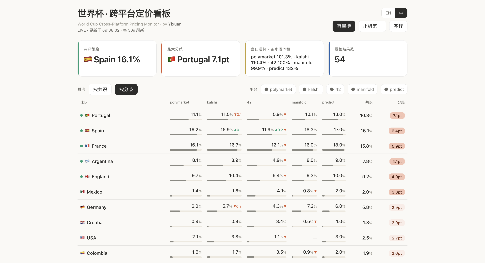

## 档案规模

| | |
|---|---|
| 追踪区间 | 2026 年 6 月 11 日 – 8 月 5 日 |
| 平台 | 5 个 |
| 已定价比赛 | 104 / 104 场 |
| 定价变动记录 | 约 20 万条 |
| 球队 | 48 支 |

## 数据说了什么

- **热门兑现率 68%**（104 场中 71 场）。越往后越低：32 强赛接近九成，八强起只剩一半。
- **平局被高估。** 市场隐含 28%，实际 19%。
- **冠军不是头号热门。** 西班牙开赛约 15%，排第二；法国约 18% 排第一，最终第四。
- **最大的看走眼：** 西班牙 0–0 佛得角。这个平局只被定价 6%。
- **准确度（Brier 分数，越低越好）。** Predict.fun（0.470）与 Kalshi（0.471）领先，Polymarket（0.497）垫底。五平台共识（0.493）没有跑赢最好的单一平台。

  *说明：各平台覆盖的比赛不同（88–104 场），这个排名只具参考性，不是严格对照。Manifold 没有单场市场，只出现在冠军争夺中。*

以上数字均由 [`archive/analyze.py`](./archive/analyze.py) 从档案重新计算，完整内容见[复盘页](https://pmwatcher.wy-x.com/analysis.html)。

## 档案如何运作

线上服务每 30 秒抓取一次五个平台。决赛之后，它变成了纯静态网站：不需要服务器、数据库或任何 API token。

- **是回放，不是截图。** 一层很薄的回放数据层（[`archive/web/archive.js`](./archive/web/archive.js)）为原前端供数。对任意时刻 *T*，它用与 `serve.py`、`history.py` 相同的算法，在浏览器里算出"T 时刻服务器会返回什么"。冠军榜、赛程、复盘、球队名片、淘汰赛、冠军机、异动时间线、弹幕，全部原样运行。
- **逐位一致。** 用原项目的 Python 在"截断到 T 的数据库"上运行，与浏览器版在 20 个时刻对拍 11,808 个字段，全部一致，四舍五入也不例外。
- **每个时刻都是一个链接。** `?t=2026-06-25T2030Z` 在任何时区打开都是同一时刻。
- **隐私。** 原始数据库含访客 IP 的哈希，不公开。公开仓库只有导出的定价、赛果与每日访问总数。

细节与重建步骤见 [`archive/README.md`](./archive/README.md)。

## 看板呈现什么

- **冠军榜**——48 强夺冠定价，五平台并排，附共识价与分歧热力（颜色越深，平台间分歧越大）
- **小组第一**——12 个小组的出线定价（Kalshi、42 数据）
- **赛程**——全部 104 场，从小组赛到决赛，由各平台自身的市场生成；点开任一场，查看跨平台的 胜/平/负 对比与价差
- **淘汰赛**——通往决赛的对阵签表，按**真实上下半区落位**，出线追踪会把已决出的胜者**前向推进**到下一轮；平行宇宙冠军机**直接内嵌在这个 tab 里**（见下）
- **新闻 × 赔率**——BBC / Guardian / ESPN / Sky 足球新闻流，外加懂球帝（中文），按球队过滤；**点开一条新闻，查看该队在新闻前后 ±3 小时的逐平台赔率**（红色虚线标记新闻时刻）
- **新闻弹幕**——新闻以弹幕形式从顶部飘过；悬停可暂停阅读、点击可打开原文，右上角按钮一键关闭
- **历史落盘**——每一笔赔率变动都写入了 SQLite（变动驱动：价格不动则不写入）。结果是五个市场为 104 场比赛定价的完整记录，也就是档案回放的数据源
- **Telegram 推送**——可选，跨平台价差越过阈值时提醒（仅实时模式）
- **中英双语界面**——右上角切换

**单场展开后的五平台 胜 / 平 / 负 对比：**

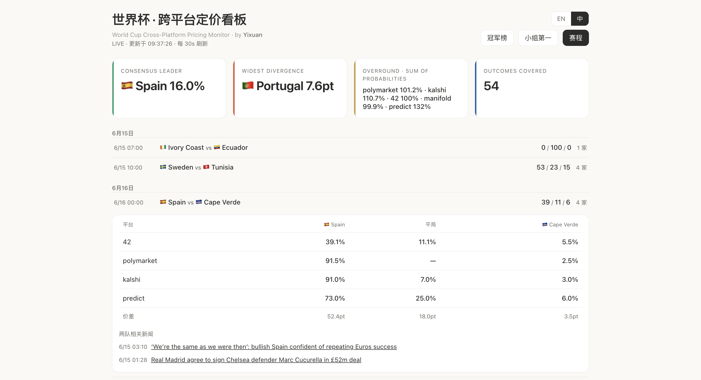

**点一条新闻，查看两队在新闻前后的赔率；⚡ 是看板捕捉到的共识异动：**

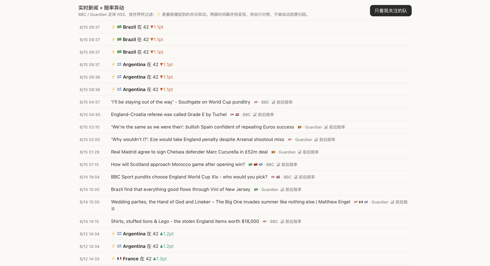

**新闻弹幕——新闻像弹幕一样从顶部飘过；把鼠标移到某条上会暂停，方便阅读或点开，右上角按钮可整体关闭：**

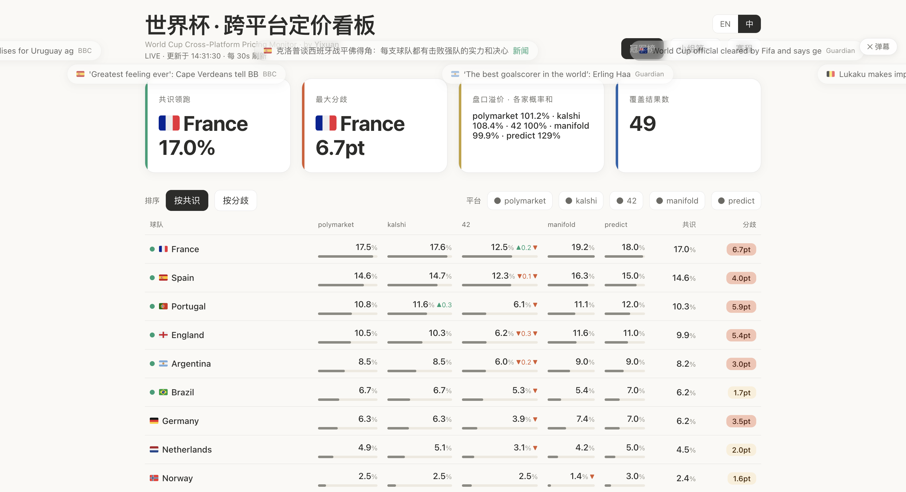

**一张图看懂新闻 × 赔率——把新闻时刻落在每个平台前后数小时的价格线上，新闻与价格变动之间的时间关系一眼可见（呈现的是时间关系，而非因果结论）：**

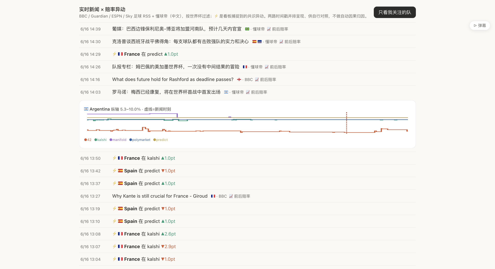

**可自选的关注列表——每张卡片显示逐平台赔率与多平台历史走势线：**

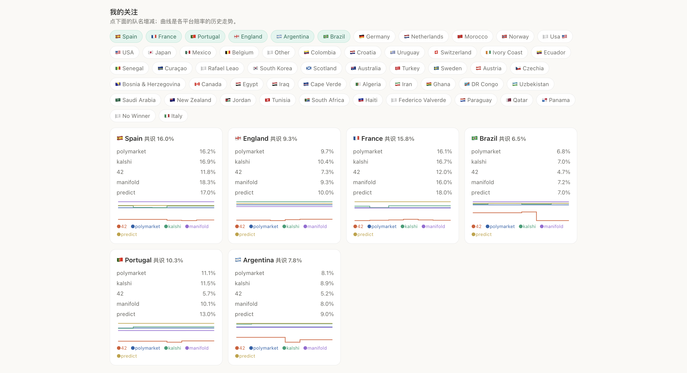

## 平行宇宙冠军机

淘汰赛把每个球迷都变成反事实思考者：***我的队要夺冠，得发生什么？*** 冠军机用一件可收藏的实体来回答。在环形科幻选择器上任选 **32 强中的一支**，机器沿**真实签表**反推它的夺冠路线——五轮、五个对手——把整个故事盖在一张可下载分享的模切**冠军通行球票**上。它**直接内嵌在「淘汰赛」tab 里**——不用跳页，嵌入区高度自适应，一键可切全屏。

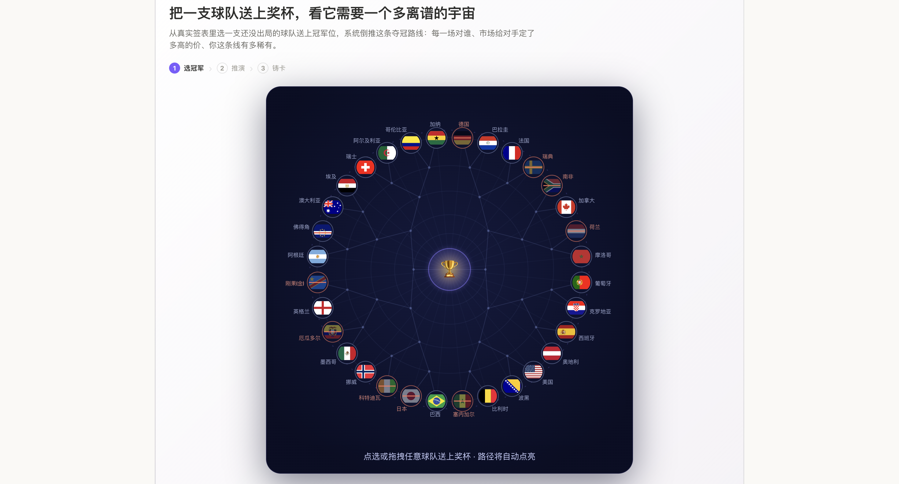

**一票五道判决。** 路线上的每一轮是一个盖章模块：对手、一枚双重叠印的**判决章**（取自手工搭建的球员梗 / 战术民俗 / 足球玄学语料库）、一行解说、两条衍生话题、一个平行宇宙比分（含加时与点球的戏剧性）——以及市场赛前给这个对手的定价，划掉，盖上**市场误判**或**定价击穿**。「再抽一个宇宙」会整库轮换取词——判决词一抽一换，同一张票内五关互不重复。

**稀有度即盲盒档位。** 整条路线的联合概率决定档位——共识款 / 稀有款 / 史诗款 / **传说款**（金箔边框）——已被淘汰的球队铸出的是**隐藏款**：一个在现实里已经终结的宇宙，是你能持有的最稀有的那种。

**一张会活着的票。** 冠军机会从看板自己的复盘数据同步已完赛的淘汰赛结果。该队真正赢下的关卡盖上 **✓ 已应验**、并显示**真实比分**——点球大战也如实呈现（`1–1 点球`）——**宇宙生命线**读作 *存活中 · 已应验 2/5*，或 *已终结 @ 1/8 决赛*。在档案里，球票反映的是你回放的那个时刻。

**国家气质长在纹理里。** 每个国家有自己的招牌纹样织进票面——日本的青海波、阿根廷的太阳放射、克罗地亚的红白格盘、摩洛哥的 zellige 八角星、墨西哥的阿兹特克回纹、英格兰的圣乔治十字……——外加冲孔撕线、票根条码、三角模切齿边。

**为传播而生。** 一键导出即得一张带柔和投影的成品 PNG（投影沿模切齿形走）；导出完成的瞬间，一段双语**发帖配文**（队名、稀有度档位、决赛判决词、存活/终结钩子）自动生成并复制进剪贴板。手机上球票会以**「长按保存」浮层**呈现，而不是无声的下载；环形选择器也针对触屏拖拽做了优化。每张票都带**可扫描的真二维码与明文网址**深链回冠军机，外加**定价快照时间戳**——校准的语言，不是预言。

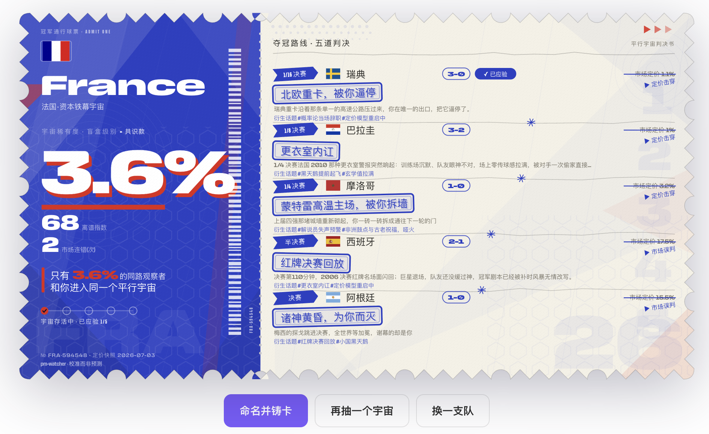

> 冠军机是建立在市场数据之上的娱乐。稀有度衡量的是**五个市场如何联合为一条路线定价**，不是球队实力。内置违禁词 lint 保证生成的每一行——判决、解说、配文——不含任何博彩语言。校准而非预测，贯穿到底。

## 复盘看板 & 球队名片

比赛一旦结束，问题就从“会发生什么”变成了 ***“谁定价定对了——其他平台又错得有多离谱？”*** 在项目的核心理念 **校准而非预测** 之下的一整层复盘能力。

### 复盘看板

- 对每一场已结束的比赛做**「赛前定价 vs 真实结果」复盘**：把赛前五平台共识与真实的 胜/平/负 并排，并给出命中或落空的判定。
- 顶部置顶一块**市场共识战绩**——共识看好的一方究竟兑现了多少次——支持一键按 *兑现 / 落空* 筛选。
- **平台校准**：一张校准曲线图，外加五个平台的 **Brier 准确度排行**。
- 每张卡片一句**可传播的标题**——有差异、不套模板、双语（英文大字标题，中文模式下附中文小字）。
- 横向**日期标签**，点哪天看哪天。
- **一键导出小卡**（1080×1350 PNG），带标题条、五平台表格，以及回到看板的**二维码 + 链接**。

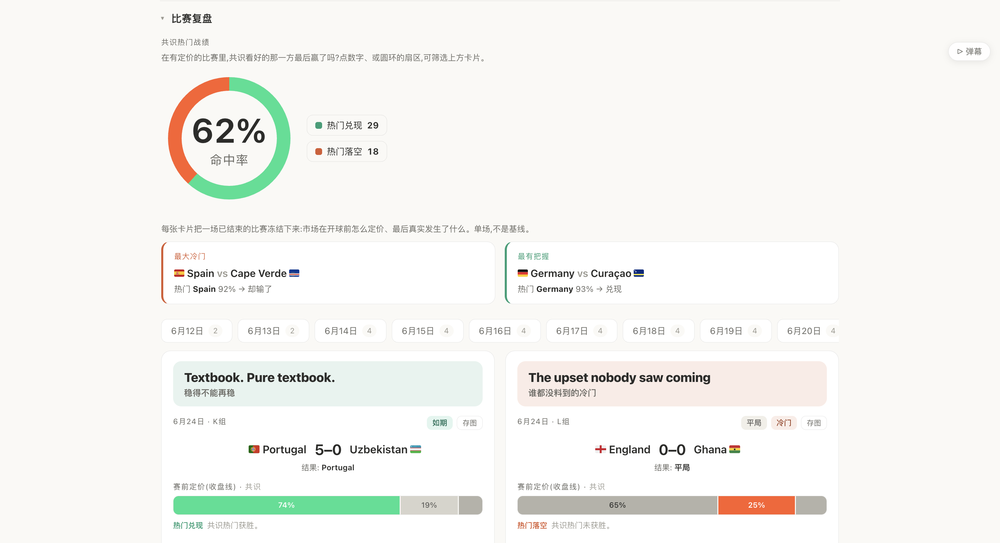

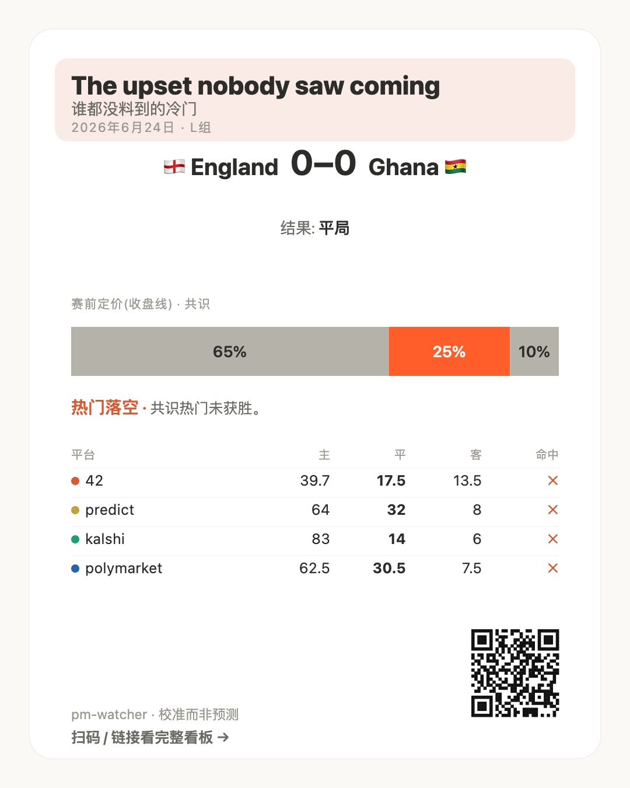

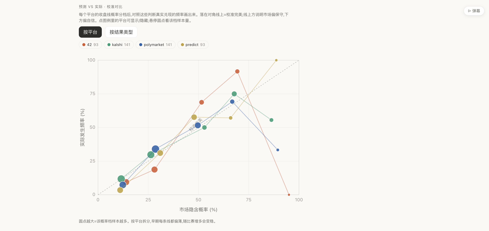

### 球队名片

- 为**全部 48 强**各做一张可收藏的小卡，采用 WC26 官方海报视觉语言——每个国家有**固定的主色 + 纹理**（12 种大块纹理，没有两国雷同），视觉系统锁定、只更新数据。
- 一个 **意外指数**（S / A / B / C，0–100）与一个巨大的 **±% 偏差**数字：市场对这支球队的定价偏离真实结果有多远（衡量的是“市场看走眼的程度”，不是球队实力）。
- 战绩、进/失球、制造的冷门，以及该队最意外的一场。
- **一键导出 PNG**，带二维码深链直达看板上的该队；中英双语；历史冠军镀金星。

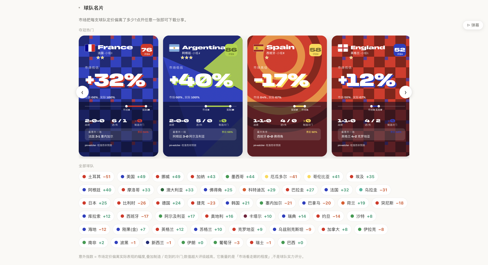

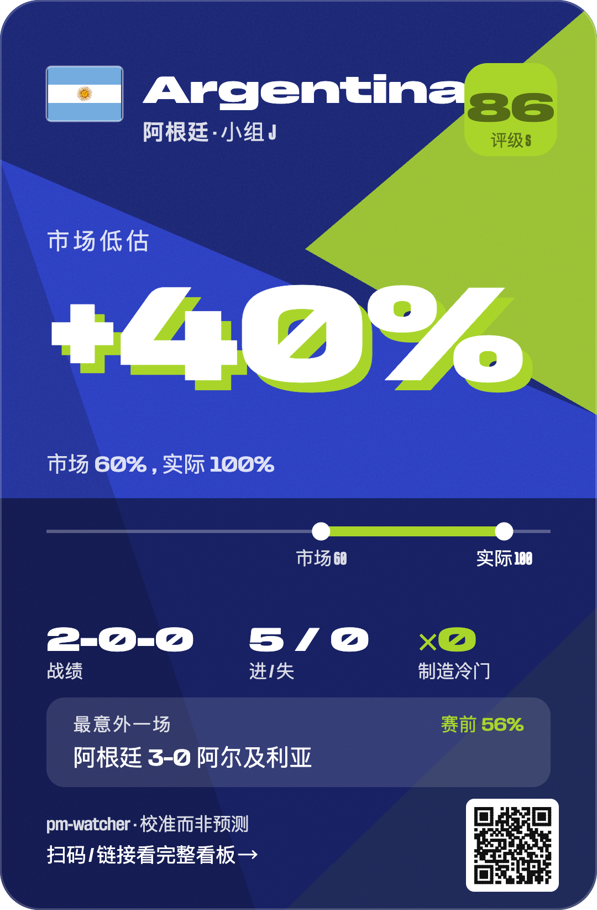

> 这两块看板都是**回顾性的、只读的**——它们描述的是市场为*已经发生*的比赛所做的定价。依然不预测、不下注。

## 快速开始

**浏览档案**——无需安装：[pmwatcher.wy-x.com](https://pmwatcher.wy-x.com/)。

**从历史数据库重建静态站：**

```bash
python3 archive/build_site.py --db history.db --site-url https://pmwatcher.wy-x.com/
python3 -m http.server 8765 -d site          # 打开 http://localhost:8765
```

站点托管在 Cloudflare Pages（输出目录 `site`，构建命令留空）。新闻补回与可选的访问计数见 [`archive/README.md`](./archive/README.md)。

**运行实时看板**——原始服务，留作参考。2026 年的市场均已结算，运行后能显示的内容很少；代码本身才是重点。

```bash
pip install -r requirements.txt

# 网页看板：
python3 -m pm_watcher.serve --live --interval 30
# 然后浏览器打开 http://127.0.0.1:8765
# 冠军机内嵌在「淘汰赛」tab（全屏视图在 /parallel-universe.html）

# 或命令行模式：
python3 -m pm_watcher.watch --query "World Cup" --board --live
```

行情数据无需 API key。部分数据源在部分网络环境下需要代理（`export HTTPS_PROXY=...`）。

可选配置放在 `.env`——复制 [`.env.example`](./.env.example) 后按需填写：复盘看板同步赛果用的 [football-data.org](https://www.football-data.org) 免费 token，以及 Telegram 推送用的 @BotFather token 与 chat id（命令行模式加 `--notify`）。

## 真正值得一看的部分：过程

跨平台比价听起来不过是"把几个数字并排"。实际做下来，每个平台都设了一道关卡——**这些字段层面的经验，比代码本身更有价值**：

1. **42 的 `price` 字段不是概率。** 它是债券曲线上的代币价（量级约 0.0008），各结果之和远不到 1。真正的隐含概率在 `marketCap` 占比里——每个结果的市值 ÷ 市场总市值，加起来正好 100%。直接用 `price`，整列数据都是错的。
2. **Kalshi 改过价格单位。** 旧字段是美分（需 ÷100），新字段 `last_price_dollars` 已是 0~1。两者同时存在于返回中，取错一个，所有概率相差 100 倍。
3. **42 的接口会拒绝"不像浏览器"的请求。** 同一个 URL，浏览器能打开，裸客户端被拒。补上 `Origin`、`Referer` 和真实 User-Agent 即可。WAF 不会告诉你它想要什么。
4. **Metaculus 的"公开 API"已不再公开。** 文档上看着可用，实际返回是 `only available to authenticated users`。判断一个 API 是否可用，唯一可靠的办法是真的请求一次。
5. **Predict.fun 官方 API 需要 key，但它的网页前端走一条开放的 GraphQL。** Introspection 全开——顺着 schema 摸下去，发现了完整的世界杯赛程接口（80 场比赛、真实开球时间）。最丰富的数据源，在文档之外。
6. **42 的单场是精确比分盘**（如 `NED 0–1 JPN`），不是胜平负盘。本项目把比分概率汇总推导为三向价；无法归类的结果诚实丢弃，因此 42 的三向之和可能略低于 100%，而非强行归一。
7. **同一支球队，在五个平台有五种名字。** Türkiye/Turkey、Korea Republic/South Korea、Cabo Verde/Cape Verde、两种 Bosnia 拼写。不做规范化归一，跨平台对比就会把同一支队当成两支。
8. **SVG 的 mask 不可移植。** 球票的冲孔撕线最初用 `<mask>` 打穿；浏览器按亮度处理 mask，部分栅格器按 alpha——同一个文件，一边打了孔，另一边毫无反应。改用 `clip-rule="evenodd"` 子路径做纯几何打孔后，模切在所有渲染器上完全一致。
9. **手机上 `a.download` 会无声失效。** 内嵌浏览器（小红书、微信）会忽略 download 属性和 blob URL——桌面上好好的"下载"按钮，到手机上点了就像没点。可靠的路径是交还给平台自己的手势：把 PNG 以 data-URL 渲染进浮层，让用户**长按保存**。
10. **已结算的市场不会离开记录。** 早期混入的板球盘、球员盘结算后下架，但最后一笔价格永远留在历史里。档案计算盘口溢价时只统计 48 支参赛队。
11. **没落盘的东西就没了。** 线上新闻流只存在内存里。为了回放，档案从互联网档案馆（Wayback Machine）补回了赛事期间的新闻。

## 架构

```
pm_watcher/                  # 实时服务（原版）
├── model.py                 # Market/Outcome 数据模型 + 客户端基类
├── polymarket.py            # Gamma API（公开 REST）
├── kalshi.py                # trade-api v2（公开 REST；KXWCGAME 单场 / KXWCGROUPWIN 小组）
├── fortytwo.py              # rest.ft.42.space（公开 REST；比分盘→三向推导）
├── manifold.py              # 公开 REST（play-money 预测者共识）
├── predict.py               # 前端公开 GraphQL（含 80 场赛程）
├── names.py                 # 国名规范化 + 48 强名单
├── aggregator.py            # 跨平台归并（榜单 / 赛程）
├── results.py               # 官方赛程与赛果
├── history.py               # SQLite 变动驱动落盘
├── news.py                  # BBC/Guardian/ESPN/Sky RSS + 懂球帝，按世界杯/球队过滤
├── notifier.py              # Telegram 推送
├── serve.py                 # 本地看板服务（http://127.0.0.1:8765）
├── dashboard.html           # 单页看板（无前端构建链）
├── parallel-universe.html   # 平行宇宙冠军机（自包含单页，~160KB，含二维码编码器）
├── fonts-subset/            # WC26 展示字体子集（woff2，合计 ~88KB）
├── fonts/ · flags/          # 完整展示字体 + 62 面国旗 SVG
└── watch.py                 # 命令行模式

archive/                     # 把实时看板变成静态回放
├── build_site.py            # 构建整个静态站点到 site/
├── analyze.py               # 全程数据分析 → site/data/analysis.json
├── backfill_news.py         # 从 Wayback Machine 补回新闻
└── web/                     # 回放数据层、时间轴控制栏、复盘页

site/                        # 部署的静态站点（Cloudflare Pages）
worker/                      # 可选的 Cloudflare Worker，用于访问计数
```

实时服务的依赖只有 `httpx`（与可选的 `python-dotenv`）。所有页面都是自包含 HTML、无前端构建链；冠军机在导出 PNG 时才把字体与国旗嵌入图内。

## 数据源

| 平台 | 性质 | 接入方式 | 概率口径 | 注意 |
|---|---|---|---|---|
| Polymarket | 现金盘（Polygon） | 公开 Gamma REST | `outcomePrices`（0~1） | 深度最好 |
| Kalshi | 现金盘（CFTC 持牌） | 公开 trade-api | `last_price_dollars` | 平局记作 "Tie" |
| 42 | 链上盘（Alpha） | 公开 REST | `marketCap` 占比 | 流动性薄；单场为比分盘 |
| Manifold | **play-money** | 公开 REST | `probability` | 预测者共识，非真钱 |
| Predict.fun | 现金盘（BNB） | 前端公开 GraphQL | `chancePercentage` | 整数粒度（0.5pt 以内为噪声） |

## 诚实边界

- **这不是套利工具。** 看板呈现的价差，绝大多数不可执行：手续费、结算口径差异、资金锁定、薄盘的不可成交性，以及平台与合约风险，都会吃掉名义价差。它的价值在于**理解市场如何为一个事件定价**，而非从中提取利润。
- **准确度排名只具参考性。** 各平台覆盖的比赛不同，104 场也是小样本。Brier 分数描述的是这一届世界杯，不是对任何平台的定论。
- **冠军机是建立在市场数据之上的娱乐。** 稀有度档位衡量的是五个市场对一条路线的联合定价，不是球队实力；所有生成文案经过违禁词 lint，不含博彩语言。
- 各平台对不同司法辖区的可用性差异很大。请自行核实你所在地的法律与各平台条款。本项目仅读取公开行情，不涉及注册、交易或资金。
- 新闻 × 赔率图呈现的是**时间关系，而非因果结论**。
- 本项目不构成任何投资建议。

## License

MIT © Yixuan

*Built in collaboration with Claude (Anthropic).*
